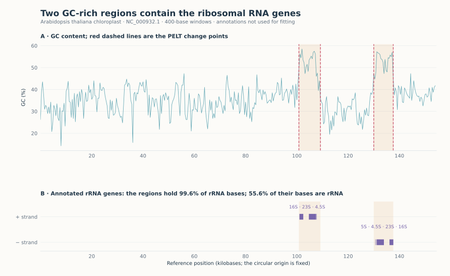

GC content along a chloroplast genome
=====================================

.. raw:: html

   

DNA is a sequence of four bases, A, C, G and T, and the proportion of G and C
(the GC content) varies along a genome. The chloroplast genome of the plant
*Arabidopsis thaliana* is a single circular molecule of 154,478 bases. Here
the ordered axis is a position along the molecule, not time: we cut it into
400-base windows, segment the GC content, and compare the segments with the
gene annotation of the same reference sequence.

   Top: GC content of each window and the change points found by PELT (red
   dashed lines); shading marks the two GC-rich segments. Bottom: ribosomal RNA
   genes on the two strands, from the annotation, which the detector does not
   see.

Result
------

PELT finds four change points. They delimit two short segments with a mean GC
content of 52–53%, against 30–38% for the rest of the genome. These two
segments cover 10.4% of the genome and contain 99.6% of the annotated
ribosomal RNA (rRNA) bases: the two copies of the rRNA gene cluster, in
opposite orientations, as expected in the two inverted repeats of a
chloroplast genome. The match is not one-to-one: 55.6% of the bases of the two
segments are annotated as rRNA, the rest being neighbouring sequence.

.. include:: _figures/chloroplast_evidence.txt

Data and method
---------------

NCBI RefSeq `NC_000932.1 <https://www.ncbi.nlm.nih.gov/nuccore/NC_000932.1>`_.
The GC percentage is computed in 386 consecutive windows of 400 bases (the
last 78 bases are dropped), standardised and passed to
:doc:`PeltDetector <../detectors/pelt>` with the default least-squares cost,
a penalty of 2 × BIC and segments of at least five windows (2,000 bases).
The seven rRNA features of the GenBank record are used only for the
comparison. A segment is called GC-rich if its mean exceeds 45%, a
descriptive threshold.

Limits
------

* The segments locate GC-rich regions, not genes. Their edges fall within one
  window of the rRNA genes but do not trace gene boundaries.
* The molecule is circular; the analysis starts at position 1 of the reference
  and ignores the junction between its two ends.

Code
----

From a source checkout, with the bundled snapshot:

.. code-block:: python

   from sklearn.preprocessing import StandardScaler

   from examples.gallery._data import load
   from tsseg.algorithms import PeltDetector

   frame = load("dna")  # one row per 400-base window
   X = StandardScaler().fit_transform(frame[["gc"]])
   detector = PeltDetector(penalty=2, pen_scale="bic", min_size=5, jump=1)
   cps = detector.fit_predict(X)
   print(frame.x.iloc[cps].tolist())  # genome position of each change point

``python -m examples.gallery.chloroplast`` reproduces the figure and the table.
Downloads: :download:`script <../../examples/gallery/chloroplast.py>` ·
:download:`features <_figures/chloroplast_features.csv>` ·
:download:`rRNA annotation <../../examples/gallery/data/annotations.csv>` ·
:download:`predictions and parameters <_figures/chloroplast.json>` ·
:download:`figure <_figures/chloroplast.svg>`.
