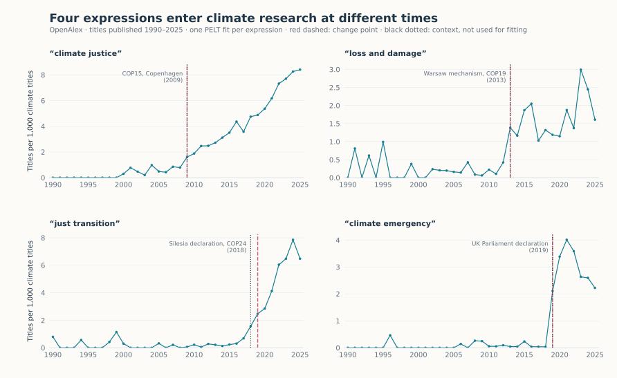

New expressions in climate research
===================================

.. raw:: html

   

Climate debates have produced their own vocabulary. Expressions such as
*climate justice* or *just transition* are now common in the IPCC assessment
reports, but six reports are too few observations to date when they took
hold. The titles of research publications give one observation per year. For
four expressions, we count the publications whose title contains the
expression, relative to the number of titles containing *climate*, from 1990
to 2025. When did each expression become established?

   Titles containing each expression per 1,000 titles containing *climate*.
   Red dashed: the change point found by PELT. Black dotted: one milestone per
   expression, shown for context.

Result
------

Each expression receives exactly one change point, at the year its rate
leaves a near-zero baseline: 2009 for *climate justice*, 2013 for *loss and
damage*, 2019 for *just transition* and *climate emergency*. The four years
are the same for all nine combinations of penalty (1, 2 or 4 × BIC) and
minimum segment length (2, 3 or 5 years) that we tried.

.. include:: _figures/climate_vocabulary_evidence.txt

The milestones were chosen after looking at the data, to help read it: they
are not a test. Nor are they first uses. *Loss and damage* already appears in
the 2007 Bali Action Plan, and *just transition* in the decisions of the 2010
Cancún conference, years before either became common in research titles.
Publication counts date when an expression spread; they do not explain why.

The scale matters. The fit uses log(1 + rate), on which the largest relative
change is the departure from zero. On the raw rate, two change points move
later, to 2015 for *climate justice* and 2021 for *just transition*: a
series that keeps growing is best split in the middle of its growth. What
counts as a change depends on what is measured.

Data and method
---------------

`OpenAlex <https://openalex.org>`_ (CC0), queried on 6 November 2026 with its
title search, which also matches inflected forms (*just transitions*). For each
year from 1990 to 2025, the rate is 1,000 × the number of titles containing
the expression divided by the number of titles containing *climate* (1,259
in 1990, 61,621 in 2025). Titles with the expression need not contain
*climate*, so the rate is a relative frequency rather than a share. Each
expression is fitted separately: log(1 + rate) is standardised and passed to
:doc:`PeltDetector <../detectors/pelt>` with the default least-squares cost,
a penalty of 2 × BIC and segments of at least three years.

Limits
------

* A title match does not distinguish meanings: *loss and damage* also occurs
  in insurance and *just transition* in labour studies. Such uses make up the
  low baseline before each change point.
* OpenAlex keeps adding and revising records, so a new query gives slightly
  different counts; the bundled snapshot fixes them.
* Change points are yearly and refer to publication dates, which lag the
  writing of a paper by months.

Code
----

From a source checkout, with the bundled snapshot:

.. code-block:: python

   from sklearn.preprocessing import StandardScaler

   from examples.gallery._data import load
   from tsseg.algorithms import PeltDetector

   frame = load("climate_titles")  # one row per expression and year
   detector = PeltDetector(penalty=2, pen_scale="bic", min_size=3, jump=1)
   for expression, series in frame.groupby("group", sort=False):
       X = StandardScaler().fit_transform(series[["log_rate"]])  # log(1 + rate)
       cps = detector.fit_predict(X)
       print(expression, series.x.iloc[cps].tolist())

``python -m examples.gallery.climate_vocabulary`` reproduces the figure and the
table. Downloads: :download:`script <../../examples/gallery/climate_vocabulary.py>` ·
:download:`counts and rates <_figures/climate_vocabulary_features.csv>` ·
:download:`predictions and parameters <_figures/climate_vocabulary.json>` ·
:download:`figure <_figures/climate_vocabulary.svg>`.
