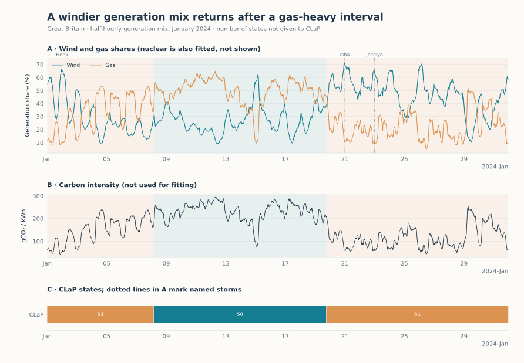

Generation mix in Great Britain
===============================

.. raw:: html

   

Britain's electricity comes from wind, gas, nuclear and other sources, in
proportions that change every half-hour with the weather and demand. In
January 2024 the shares of wind and gas swung widely from one day to the
next. Beyond these fluctuations, does the system move between a few lasting
mixes, and does an earlier mix come back?

   Top: wind and gas shares, shaded by state; dotted lines mark named storms.
   Middle: carbon intensity, which the detector does not see. Bottom: the
   states found by CLaP.

Result
------

CLaP, which estimates the number of states itself, finds two. A windier state
(on average 40% wind and 27% gas) covers the first week of January. It gives
way on 8 January to a gas-heavy state (27% wind, 49% gas), during the cold
spell described in the `Met Office account of the month
<https://www.metoffice.gov.uk/blog/2024/a-month-of-contrasts-for-januarys-weather>`_,
and returns from 19 January, ahead of storms Isha and Jocelyn. The windier
state has the same label on both sides of the gas-heavy interval: a change
point detector would report two boundaries, without saying that the first and
last periods are alike. The carbon intensity of electricity averages 128
gCO₂/kWh in the windier state and 231 in the gas-heavy one.

.. include:: _figures/electricity_evidence.txt

Data and method
---------------

National generation mix from the `Carbon Intensity API
<https://carbonintensity.org.uk/>`_ (National Energy System Operator,
Environmental Defense Fund and University of Oxford; CC BY 4.0), for
every half-hour of January 2024 (1,488 observations). The wind, gas and
nuclear shares are standardised and passed to
:doc:`ClapDetector <../detectors/clap>` with windows of 12 half-hours (six
hours) and the Euclidean distance, which keeps differences in level that a
z-normalised distance would remove. Carbon intensity, from a separate endpoint,
is used only for the comparison.

Limits
------

* Carbon intensity is calculated from the generation mix, so its difference
  between states follows from the mix; it is not an independent confirmation.
* Two states are a coarse summary: within each, the shares still swing from
  day to day.

Code
----

From a source checkout, with the bundled snapshot (CLaP needs the ``aeon``
and ``accelerators`` extras):

.. code-block:: python

   from sklearn.preprocessing import StandardScaler

   from examples.gallery._data import load
   from tsseg.algorithms import ClapDetector

   frame = load("grid")  # one row per half-hour, generation shares in %
   X = StandardScaler().fit_transform(frame[["wind", "gas", "nuclear"]])
   detector = ClapDetector(
       window_size=12,
       distance="euclidean_distance",
       n_splits=3,
       sample_size=256,
       random_state=42,
   )
   states = detector.fit_predict(X)  # one label per half-hour
   print(frame.assign(state=states).groupby("state")[["wind", "gas"]].mean())

``python -m examples.gallery.electricity`` reproduces the figure and the table.
Downloads: :download:`script <../../examples/gallery/electricity.py>` ·
:download:`features and carbon intensity <_figures/electricity_features.csv>` ·
:download:`predictions and parameters <_figures/electricity.json>` ·
:download:`figure <_figures/electricity.svg>`.
