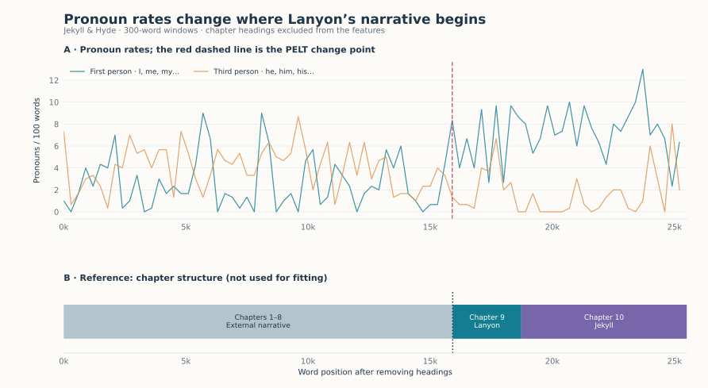

Narrative voice in *Jekyll and Hyde*
====================================

.. raw:: html

   

Most of Robert Louis Stevenson's *Strange Case of Dr Jekyll and Mr Hyde* is
told by an outside narrator who follows the lawyer Utterson. The last two
chapters change frame: they are written testimonies, first by Dr Lanyon, then
by Jekyll himself. Can this change be located from word counts alone, without
the chapter structure?

   Pronoun rates in consecutive 300-word windows. The red dashed line is the
   change point found by PELT; the band below shows the chapter structure,
   which the detector does not see.

Result
------

PELT finds a single change point, at word 15,900. Chapter 9, Lanyon's
narrative, begins at word 15,920, inside the same window. After the change,
first-person pronouns are almost three times as frequent (7.2 per 100 words,
against 2.5), and third-person masculine pronouns less than half as frequent
(1.7 against 4.0).

.. include:: _figures/jekyll_evidence.txt

Data and method
---------------

The text is `Project Gutenberg ebook 43 <https://www.gutenberg.org/ebooks/43>`_.
Chapter headings are removed and the text is cut into consecutive windows of
300 words; the last, incomplete window is dropped (85 windows). Each window gives
two rates per 100 words: first-person pronouns (*I*, *me*, *my*, *mine*,
*myself*, and contractions such as *I'm*) and third-person masculine pronouns
(*he*, *him*, *his*, *himself*). Both rates are standardised and passed to
:doc:`PeltDetector <../detectors/pelt>` with the default least-squares cost,
a penalty of 2 × BIC and segments of at least five windows.

Limits
------

* The change point is located to within one window, 300 words. The 20-word gap
  with chapter 9 reflects where the windows happen to fall.
* Pronoun rates capture the narrative frame, not the narrator: Lanyon and
  Jekyll both write in the first person, and dialogue in earlier chapters also
  uses *I*.
* The same approach did not recover the embedded narratives of
  *Frankenstein* as cleanly; this novel was chosen after that attempt.

Code
----

From a source checkout, with the bundled snapshot:

.. code-block:: python

   from sklearn.preprocessing import StandardScaler

   from examples.gallery._data import load
   from tsseg.algorithms import PeltDetector

   frame = load("novel")  # one row per 300-word window
   X = StandardScaler().fit_transform(frame[["first_person", "third_person"]])
   detector = PeltDetector(penalty=2, pen_scale="bic", min_size=5, jump=1)
   cps = detector.fit_predict(X)
   print(frame.x.iloc[cps].tolist())  # word position of each change point

``python -m examples.gallery.jekyll`` reproduces the figure and the table.
Downloads: :download:`script <../../examples/gallery/jekyll.py>` ·
:download:`features and reference <_figures/jekyll_features.csv>` ·
:download:`predictions and parameters <_figures/jekyll.json>` ·
:download:`figure <_figures/jekyll.svg>`.
