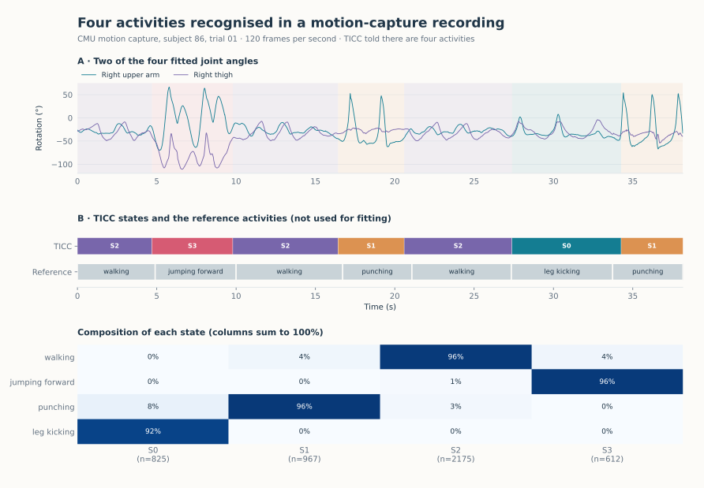

Human activities in motion capture
==================================

.. raw:: html

   

A motion-capture system records the rotation of body joints many times per
second. In trial 01 of subject 86 of the CMU Motion Capture Database, a person
walks, jumps forward, walks, punches, walks, kicks and punches again, in 38
seconds. This recording is the first series of the MoCap dataset bundled with
tsseg. Given only four joint angles, can a state detector recognise each
activity, and give walking the same label each of the three times it occurs?

   Top: two of the four joint angles, shaded by state. Middle: TICC states
   above the reference activities, which the detector does not see. Bottom:
   share of each activity in each state.

Result
------

Told that there are four activities, TICC finds the six transitions of the
reference and nothing else. Each state corresponds to one activity: walking
receives the same state on its three occurrences, punching on its two. After
matching states to activities, 95.3% of the frames are correctly labelled
(ARI 0.880). Each transition falls within 0.53 s of the reference.

The reference itself is uncertain at this scale: a second annotation of the
same recording, by Barbič et al. (2004), places the transitions up to 0.68 s
away from it.

Time order matters. K-means on the same angles, with four clusters, reaches an
ARI of 0.197 and changes label 48 times: an arm can pass through the same
angle while walking or punching. TICC without its switching penalty
(``beta=0``) reaches 0.443.

.. include:: _figures/mocap_evidence.txt

Data and method
---------------

The data are bundled with tsseg: ``load_mocap(trial=0)`` returns the four
channels (first rotation axis of the right and left upper arm and thigh) at
120 frames per second, 4,579 frames, with one activity label per frame. The
labels are those used to evaluate Time2State (Wang et al., 2023); the activity
names come from the annotation of Barbič et al. The angles are standardised and passed to
:doc:`TiccDetector <../detectors/ticc>` with four states, windows of three
frames and a switching penalty of 3,000. These are the default settings of the
TSB-SEG benchmark, not tuned on this recording. A window of several frames lets
TICC model how the joints move together over time, not only their positions.

Limits
------

* The number of activities is given. Without it, results on this recording
  depend more on the detector and its random seed: HDP-HSMM, for instance,
  ranged from an ARI of 0.12 to 0.87 over five seeds.
* One recording of one person, with long, clearly separated activities.
* Four angles describe the movement only partly: the full recording has 62
  degrees of freedom.

The CMU data come with this acknowledgement: *The data used in this project was
obtained from mocap.cs.cmu.edu. The database was created with funding from NSF
EIA-0196217.*

Code
----

The dataset ships with tsseg, so this runs from an installed package:

.. code-block:: python

   import numpy as np
   from sklearn.preprocessing import StandardScaler

   from tsseg.algorithms import TiccDetector
   from tsseg.data.datasets import load_mocap

   X, y = load_mocap(trial=0)  # 4,579 frames x 4 joint angles, activity labels
   X = StandardScaler().fit_transform(X)
   np.random.seed(42)  # TICC draws from NumPy's global generator
   detector = TiccDetector(
       n_states=4,
       window_size=3,  # frames per window
       lambda_parameter=1e-3,  # sparsity of the inverse covariances
       beta=3000,  # switching penalty
       maxIters=100,
       threshold=1e-3,
   )
   states = detector.fit_predict(X)  # one label per frame

``python -m examples.gallery.mocap`` reproduces the figure and the table;
``python -m examples.gallery.kmeans_baseline`` reproduces the k-means
comparison. Downloads: :download:`script <../../examples/gallery/mocap.py>` ·
:download:`angles and activities <_figures/mocap_features.csv>` ·
:download:`predictions and parameters <_figures/mocap.json>` ·
:download:`k-means comparison <_figures/kmeans_baseline.json>` ·
:download:`figure <_figures/mocap.svg>`.
