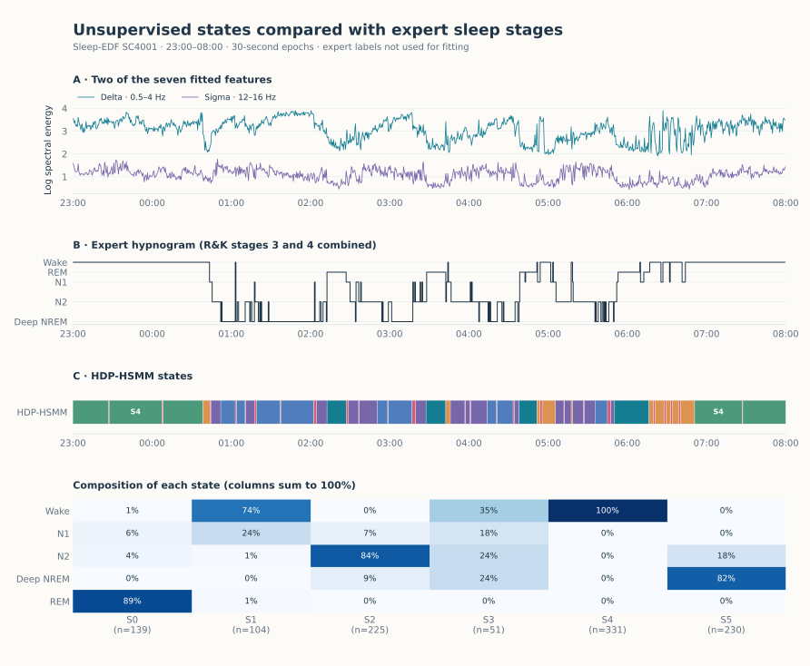

Sleep stages from one night of recordings
=========================================

.. raw:: html

   

During sleep, brain activity, eye movements and muscle tone go through
recognisable patterns. A trained scorer labels every 30 seconds of a
recording as wake, light sleep (N1, N2), deep sleep or REM sleep. Without
these labels, does a state model fitted to the recordings find groups that
correspond to them?

   From top to bottom: two of the seven features; the expert hypnogram, which
   the detector does not see; the HDP-HSMM states; the share of each expert
   stage in each state.

Result
------

HDP-HSMM, allowed up to six states, uses all six. Two correspond clearly to
expert stages: one holds 99.2% of the REM epochs (and is 89% REM), another
85.5% of the deep-sleep epochs (and is 82% deep sleep). Wake is split between
two states, and the short, transitional N1 stage is spread over several.
Overall, the ARI with the expert hypnogram is 0.655, and 79.4% of epochs agree
once each state is matched to one stage.

K-means on the same features, which ignores time order, reaches an ARI of
0.519 and changes label 294 times, against 67 for HDP-HSMM.

.. include:: _figures/sleep_evidence.txt

Data and method
---------------

Recording SC4001E0 and its hypnogram SC4001EC from `Sleep-EDF Expanded
<https://physionet.org/content/sleep-edfx/1.0.0/>`_ (Kemp and colleagues,
PhysioNet, Open Data Commons Attribution License v1.0), from 23:00 to 08:00:
1,080 epochs of 30 seconds. Seven features per epoch: log power of the Fpz–Cz
EEG in the delta, theta, alpha, sigma and beta bands, low-frequency energy of
the horizontal EOG, and the log mean of the chin EMG envelope (Welch spectra
over 4-second windows). Stages 3 and 4 of the Rechtschaffen and Kales scoring
are merged as deep sleep. The features are standardised and passed to
:doc:`HdpHsmmDetector <../detectors/hdp_hsmm>` with at most six states, 30
sampling iterations and state durations of 1 + Poisson(λ) epochs, with a
prior mean of 20 epochs (ten minutes).

Limits
------

* One night of one person: nothing here says how well this carries over to
  other recordings.
* The correspondence between states and stages is read from the expert labels
  after fitting; the states are not sleep stages by construction.
* The sampler stops after 30 iterations with a fixed seed. With two other
  seeds, the ARI is 0.572 and 0.614.

Code
----

From a source checkout, with the bundled snapshot:

.. code-block:: python

   import numpy as np
   from sklearn.preprocessing import StandardScaler

   from examples.gallery._data import load
   from tsseg.algorithms import HdpHsmmDetector

   frame = load("sleep")  # one row per 30-second epoch
   eeg = ["ch0_delta", "ch0_theta", "ch0_alpha", "ch0_sigma", "ch0_beta"]
   X = StandardScaler().fit_transform(frame[[*eeg, "ch2_delta", "emg"]])
   np.random.seed(42)  # the sampler draws from NumPy's global generator
   detector = HdpHsmmDetector(
       n_max_states=6,
       n_iter=30,
       trunc=120,  # longest state duration, in epochs
       dur_alpha=5,
       dur_beta=5 / 19,  # prior mean of the Poisson duration: 19 (+1) epochs
       emission_strength=10,
   )
   states = detector.fit_predict(X)  # one label per epoch

``python -m examples.gallery.sleep`` reproduces the figure and the table;
``python -m examples.gallery.kmeans_baseline`` reproduces the k-means
comparison. Downloads: :download:`script <../../examples/gallery/sleep.py>` ·
:download:`features and expert stages <_figures/sleep_features.csv>` ·
:download:`predictions and parameters <_figures/sleep.json>` ·
:download:`k-means comparison <_figures/kmeans_baseline.json>` ·
:download:`figure <_figures/sleep.svg>`.
