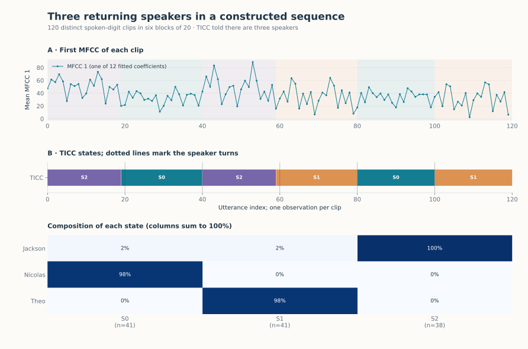

Returning speakers
==================

.. raw:: html

   

When several people take turns, the same voice comes back several times. A
state detector should give it the same label at each return, whatever is
being said. We build such a sequence from the Free Spoken Digit Dataset: 120
short recordings of digits by three speakers, arranged in six turns of 20
recordings (Jackson, Nicolas, Jackson, Theo, Nicolas, Theo). Every turn
contains each digit twice, and no recording is used twice.

   Top: one of the twelve features, shaded by state. Middle: TICC states;
   dotted lines mark the speaker turns, which the detector does not see.
   Bottom: share of each speaker in each state.

Result
------

Told that there are three speakers, TICC recovers the six turns and gives both
turns of each speaker the same label. After matching labels to speakers, 118
of the 120 recordings are assigned to the right person (ARI 0.950).

Time order is what makes this possible. K-means on the same features, with
three clusters, reaches an ARI of 0.044 and changes label 87 times: a single
recording is too noisy to reveal its speaker. TICC without its switching
penalty (``beta=0``) does no better, with an ARI of 0.027.

.. include:: _figures/speakers_evidence.txt

Data and method
---------------

`Free Spoken Digit Dataset v1.0.10
<https://github.com/Jakobovski/free-spoken-digit-dataset/tree/v1.0.10>`_
(Zohar Jackson and contributors, CC BY-SA 4.0), takes 5 to 8. After trimming
silence at both ends, each recording is described by the mean of its MFCCs 1
to 12 (8 kHz, 256-sample window, 80-sample hop). The twelve features are
standardised and passed to :doc:`TiccDetector <../detectors/ticc>` with three
states, one recording per window and a switching penalty of 20. Speaker
names, digits and turns are used only for the comparison.

Limits
------

* The sequence is constructed. Long, balanced turns make the task easier than
  a real conversation, where turns are short and voices overlap.
* The number of speakers is given. Selecting it automatically (TICC with BIC
  over one to five states) merged two of the three voices.
* Each speaker was recorded in their own conditions, so the states may partly
  reflect the recording setup rather than the voice.

Code
----

From a source checkout, with the bundled snapshot:

.. code-block:: python

   import numpy as np
   from sklearn.preprocessing import StandardScaler

   from examples.gallery._data import load
   from tsseg.algorithms import TiccDetector

   frame = load("speech")  # one row per recording, mean MFCCs 1-12
   X = StandardScaler().fit_transform(frame[[f"mfcc_{i:02}" for i in range(1, 13)]])
   np.random.seed(42)  # TICC draws from NumPy's global generator
   detector = TiccDetector(n_states=3, window_size=1, beta=20, maxIters=30)
   states = detector.fit_predict(X)
   print(frame.assign(state=states).groupby("state").speaker_name.value_counts())

``python -m examples.gallery.speakers`` reproduces the figure and the table;
``python -m examples.gallery.kmeans_baseline`` reproduces the k-means
comparison. Downloads: :download:`script <../../examples/gallery/speakers.py>` ·
:download:`features and speakers <_figures/speakers_features.csv>` ·
:download:`predictions and parameters <_figures/speakers.json>` ·
:download:`k-means comparison <_figures/kmeans_baseline.json>` ·
:download:`figure <_figures/speakers.svg>`.
