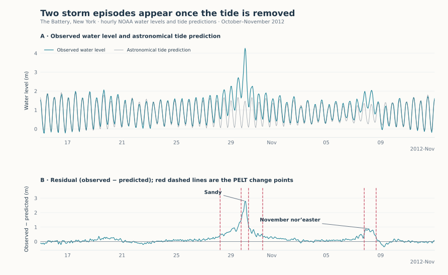

Storm surge at The Battery, New York
====================================

.. raw:: html

   

At a tide gauge, the effect of a storm is mixed with the tide, which raises
and lowers the water twice a day. NOAA publishes, for every hour, both the
observed water level and the level predicted from the astronomical tide alone.
Their difference, the residual, keeps what the tide does not explain. We
segment this residual over four weeks around Hurricane Sandy, in October and
November 2012.

   Top: observed level and tide prediction. Bottom: their difference, with the
   change points found by PELT (red dashed lines).

Result
------

PELT places six change points. Four describe Sandy: the residual rises from
28 October, peaks at 2.79 m above the prediction in the night of 29 to 30
October, then falls back in two steps. The last two isolate a smaller
episode on 7–8 November (peak 0.89 m), during the nor'easter that followed
Sandy a week later. In the observed level, this second episode is hard to
tell apart from an ordinary high tide; in the residual it stands out.

.. include:: _figures/storm_surge_evidence.txt

NOAA reports a peak surge of 2.87 m at this gauge during Sandy
(`retrospective <https://www.weather.gov/okx/HurricaneSandy5Year>`_); hourly
sampling misses the exact maximum. The November storm is documented in a
`separate NOAA summary <https://www.weather.gov/phi/11072012wss>`_.

Data and method
---------------

NOAA CO-OPS station 8518750 (The Battery): verified hourly water levels and
astronomical tide predictions from 15 October to 12 November 2012, in metres
above the MLLW datum, UTC (696 hours, no gap). The residual is standardised
and passed to :doc:`PeltDetector <../detectors/pelt>` with the default
least-squares cost, a penalty of 4 × BIC and segments of at least 12 hours.

Limits
------

* A change point marks a change in the mean residual, not the start of a
  storm: Sandy alone accounts for four.
* The residual contains everything the tide prediction leaves out (wind,
  pressure, river flow, prediction error). Weather records, not the data,
  attribute the two episodes to the two storms.

Code
----

From a source checkout, with the bundled snapshot:

.. code-block:: python

   from sklearn.preprocessing import StandardScaler

   from examples.gallery._data import load
   from tsseg.algorithms import PeltDetector

   frame = load("tides")  # hourly observed level, tide prediction and residual
   X = StandardScaler().fit_transform(frame[["residual"]])
   detector = PeltDetector(penalty=4, pen_scale="bic", min_size=12, jump=1)
   cps = detector.fit_predict(X)
   print(frame.x.iloc[cps].tolist())  # first hour (UTC) of each new segment

``python -m examples.gallery.storm_surge`` reproduces the figure and the table.
Downloads: :download:`script <../../examples/gallery/storm_surge.py>` ·
:download:`features <_figures/storm_surge_features.csv>` ·
:download:`predictions and parameters <_figures/storm_surge.json>` ·
:download:`figure <_figures/storm_surge.svg>`.
