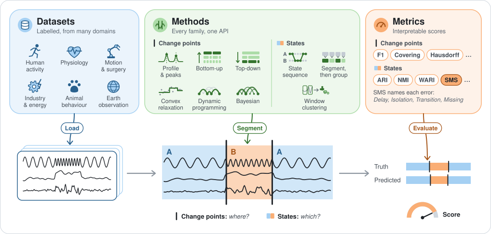
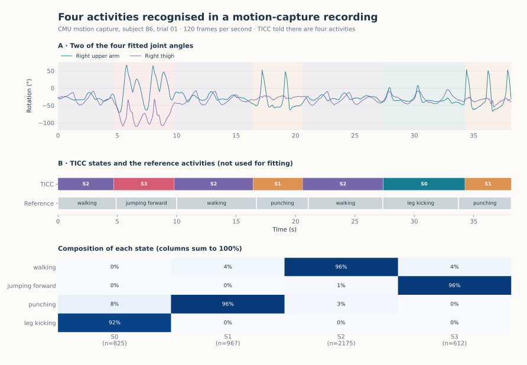
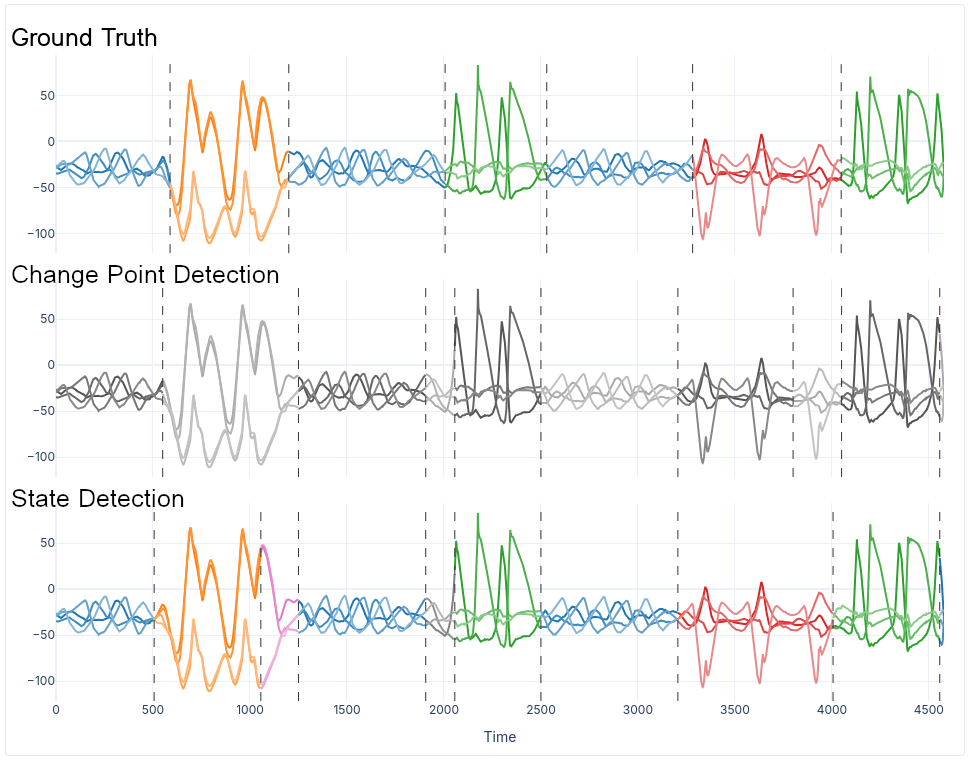

:html_theme.sidebar_secondary.remove:

.. title:: tsseg: time series segmentation in Python

.. rst-class:: tsseg-landing

tsseg: time series segmentation in Python
=========================================

.. raw:: html

   

     

       <a class="ts-pill" href="https://doi.org/10.1007/978-3-032-37685-5_41">
         <b>ECML-PKDD 2026</b>Read the demo paper
       </a>
       
Time series segmentation in Python

       
Change point detection and state detection: 30+ algorithms behind one
         scikit-learn-style API, with the metrics to evaluate them.

       

         $<code>pip install tsseg</code>
         <button type="button" class="ts-copy" data-ts-copy="pip install tsseg" aria-label="Copy the install command">
           <svg viewBox="0 0 16 16" aria-hidden="true"><rect x="5" y="5" width="8.5" height="8.5" rx="2"/><path d="M3 10.5V4a1.5 1.5 0 0 1 1.5-1.5H11"/></svg>Copy
         </button>
       

       

         <a class="ts-btn ts-btn-primary" href="guides/getting-started.html">Get started
           <svg viewBox="0 0 16 16" aria-hidden="true"><path d="M3 8h9M8.5 4.5L12 8l-3.5 3.5"/></svg></a>
         <a class="ts-btn" href="taxonomy.html">Explore the taxonomy</a>
         <a class="ts-btn" href="https://huggingface.co/spaces/fchavelli/tsseg">Live demo
           <svg viewBox="0 0 16 16" aria-hidden="true"><path d="M6 3.5h6.5V10M12.5 3.5L4 12"/></svg></a>
       

     

     

       
<i></i><i></i><i></i>detector.fit_predict(X)

.. raw:: html
   :file: _includes/hero.svg

.. raw:: html

     

   

   

     
<b>30+</b>detectors, classic to deep

     
<b>2</b>tasks: change points and states

     
<b>11</b>evaluation metrics

     
<b>592</b>series benchmarked in TSB-SEG

   

   <section class="ts-section">
     

       What is tsseg?
       <h2 class="ts-h2">Two questions about one series</h2>
       
tsseg gathers classic and recent algorithms for time series segmentation
         behind a single API. It covers the two faces of the problem.

     

     

       

         Change point detection
         <h3>Where does the behaviour change?</h3>
         <svg viewBox="0 0 240 70" aria-hidden="true">
           <path class="mini-cp" d="M65 10V64M127 10V64M177 10V64"/>
           <path class="mini-tri" d="M60 2h10l-5 7zM122 2h10l-5 7zM172 2h10l-5 7z"/>
           <path class="mini-line" d="M4 50Q10 46 16 51T28 50T40 49T52 51T64 50L66 26Q72 22 78 27T90 26T102 25T114 27T126 26L128 46Q134 42 140 47T152 46T164 45T176 47L178 24Q184 20 190 25T202 24T214 23T226 25T236 24"/>
         </svg>
         <dl class="ts-io">
           <dt>Output</dt><dd>the sorted indices where a new segment starts</dd>
           <dt>Example</dt><dd><code>[580, 1125, 2050, 2465, 3995]</code></dd>
         </dl>
         

           <a href="detectors/index.html#change-point-detection">Change point detectors &rarr;</a>
           <a href="taxonomy.html#task=cpd">In the taxonomy &rarr;</a>
         

       

       

         State detection
         <h3>Which recurring state is each point in?</h3>
         <svg viewBox="0 0 240 70" aria-hidden="true">
           <path class="mini-line" d="M4 34Q10 30 16 35T28 34T40 33T52 35T64 34L66 10Q72 6 78 11T90 10T102 9T114 11T126 10L128 30Q134 26 140 31T152 30T164 29T176 31L178 8Q184 4 190 9T202 8T214 7T226 9T236 8"/>
           <rect class="mini-a" x="4" y="50" width="60" height="16" rx="4"/><text class="mini-txt" x="34" y="61.5" text-anchor="middle">A</text>
           <rect class="mini-b" x="66" y="50" width="60" height="16" rx="4"/><text class="mini-txt" x="96" y="61.5" text-anchor="middle">B</text>
           <rect class="mini-a" x="128" y="50" width="48" height="16" rx="4"/><text class="mini-txt" x="152" y="61.5" text-anchor="middle">A</text>
           <rect class="mini-b" x="178" y="50" width="58" height="16" rx="4"/><text class="mini-txt" x="207" y="61.5" text-anchor="middle">B</text>
         </svg>
         <dl class="ts-io">
           <dt>Output</dt><dd>one integer label per time point</dd>
           <dt>Example</dt><dd><code>[0, 0, …, 2, 2, …, 1, 1, …, 0, 0, …]</code></dd>
         </dl>
         

           <a href="detectors/index.html#state-detection">State detectors &rarr;</a>
           <a href="taxonomy.html#task=sd">In the taxonomy &rarr;</a>
         

       

     

     

         (human activity, physiology, motion and surgery, industry and energy,
         animal behaviour, Earth observation) is segmented by a method from any
         family, behind one API, into change points and recurring states (A, B,
         then A again); metrics such as F1, Covering, ARI and the State Matching
         Score evaluate it against the truth

.. raw:: html

     

   </section>

   <section class="ts-section">
     

       Highlights
       <h2 class="ts-h2">Ready for your own series</h2>
     

     

       

         <svg viewBox="0 0 24 24" aria-hidden="true"><path d="M8 4c-2 0-3 1-3 3v2c0 1.2-.8 2-2 2 1.2 0 2 .8 2 2v2c0 2 1 3 3 3M16 4c2 0 3 1 3 3v2c0 1.2.8 2 2 2-1.2 0-2 .8-2 2v2c0 2-1 3-3 3"/></svg>
         <h3>One API for every method</h3>
         
Each detector is a scikit-learn estimator that follows the segmenter interface of
           <a href="https://github.com/aeon-toolkit/aeon">aeon</a>: <code>fit</code>, <code>predict</code>,
           <code>fit_predict</code>, <code>get_params</code>, <code>clone</code>.

       

       

         <svg viewBox="0 0 24 24" aria-hidden="true"><path d="M4 7h9M17 7h3M4 17h3M11 17h9"/><circle cx="15" cy="7" r="2"/><circle cx="9" cy="17" r="2"/></svg>
         <h3>Unsupervised or guided</h3>
         
Run a detector without knowing how many segments to expect, or pass the number of change
           points or states to its constructor when you know it. Tags tell which modes each detector supports.

       

       

         <svg viewBox="0 0 24 24" aria-hidden="true"><path d="M4 20h16M6 20v-7M10 20V6M14 20v-9M18 20V9"/></svg>
         <h3>Benchmarked</h3>
         
<a href="https://github.com/fchavelli/TSB-SEG">TSB-SEG</a> (NeurIPS 2026) evaluates 26 tsseg
           detectors on 592 series from 8 datasets, for both tasks, and publishes every run: pick a
           method from measured results.

       

     

   </section>

   <section class="ts-section">
     

       

         Quick start
         <h2 class="ts-h2">Segment a recording in a few lines</h2>
         
Segment a motion-capture recording bundled with tsseg, then score both
           results against its ground truth.

         <ol class="ts-steps">
           <li><b>Install</b> tsseg; the state detector of this example needs
             <code>pip install "tsseg[accelerators,aeon]"</code>.</li>
           <li><b>Load</b> a series: a NumPy array of shape <code>(n_timepoints, n_channels)</code>,
             a pandas Series or DataFrame.</li>
           <li><b>Fit and predict</b> with any detector, then <b>score</b> the result.</li>
         </ol>
         

           <a class="ts-btn" href="guides/getting-started.html">Getting started</a>
           <a class="ts-btn" href="guides/installation.html">Installation</a>
         

       

       

         
<i></i><i></i><i></i>quickstart.py

.. code-block:: python

   from tsseg import load_mocap
   from tsseg.algorithms import BottomUpDetector, ClapDetector
   from tsseg.algorithms.utils import extract_cps
   from tsseg.metrics import Covering, StateMatchingScore

   # 4 channels (arms and legs), one activity label per time point
   X, y = load_mocap(trial=0)  # X: (4579, 4), y: (4579,)
   true_cps = extract_cps(y)  # [ 588 1200 2006 2530 3282 4048]

   # Change point detection: where does the movement change?
   cps = BottomUpDetector(model="rbf", pen_scale="bic").fit_predict(X)
   print(cps)  # [ 580 1125 2050 2465 3995]
   print(Covering().compute(true_cps, cps, n_timepoints=len(X))["score"])  # 0.748

   # State detection: which activity is each time point in?
   states = ClapDetector().fit_predict(X)
   print(StateMatchingScore().compute(y, states)["score"])  # 0.700

   # Know how many segments to expect? Pass it to the constructor (guided mode)
   from tsseg.algorithms import DynpDetector

   print(DynpDetector(model="rbf", n_cps=6).fit_predict(X))
   # [ 595 1145 2160 2455 3300 4115]

.. raw:: html

       

     

   </section>

   <section class="ts-section">
     

       

         Examples
         <h2 class="ts-h2">Eight worked examples on public data</h2>
         
From the narrative voice of a Victorian novel to a night of sleep
           recordings: each example asks a question about a real record, answers it with one
           detector and checks the result against a reference the detector never sees.

         

           <a class="ts-btn ts-btn-primary" href="examples/index.html">Browse the examples
             <svg viewBox="0 0 16 16" aria-hidden="true"><path d="M3 8h9M8.5 4.5L12 8l-3.5 3.5"/></svg></a>
         

       

       

         recognised by TICC and their composition

.. raw:: html

       

     

   </section>

   <section class="ts-section">
     

       

         Find the right method
         <h2 class="ts-h2">An interactive map of the methods</h2>
         
Every detector placed by how it searches for a segmentation and by what
           makes a segment homogeneous. Filter by task, mode or install, search by name or idea,
           and open any method in one click.

         

           <a class="ts-btn ts-btn-primary" href="taxonomy.html">Open the taxonomy
             <svg viewBox="0 0 16 16" aria-hidden="true"><path d="M3 8h9M8.5 4.5L12 8l-3.5 3.5"/></svg></a>
           <a class="ts-btn" href="detectors/index.html">All detectors</a>
         

       

.. tsseg-taxonomy-preview:: taxonomy

.. raw:: html

     

   </section>

   <section class="ts-section">
     

       

         Interactive demo
         <h2 class="ts-h2">Try it in the browser</h2>
         
The tsseg demo on Hugging Face Spaces loads a series, runs segmentation
           algorithms, then compares and evaluates their results, with nothing to install.

         

           <a class="ts-btn ts-btn-primary" href="https://huggingface.co/spaces/fchavelli/tsseg">Open the demo
             <svg viewBox="0 0 16 16" aria-hidden="true"><path d="M6 3.5h6.5V10M12.5 3.5L4 12"/></svg></a>
         

       

       

.. raw:: html

       

     

   </section>

   <section class="ts-section">
     

       

         Cite tsseg
         <h2 class="ts-h2">Published at ECML-PKDD 2026</h2>
         

           Demo Track &middot; Lecture Notes in Computer Science
           <h3>tsseg: An Interactive Toolkit for Time Series Segmentation</h3>
           
Félix Chavelli, Arik Ermshaus, Fan Yang, Patrick Schäfer, John Paparrizos, Paul Boniol

           <a class="ts-btn" href="https://doi.org/10.1007/978-3-032-37685-5_41">doi:10.1007/978-3-032-37685-5_41</a>
         

         
Please also cite:

         <ul class="ts-also">
           <li><a href="https://github.com/fchavelli/TSB-SEG">TSB-SEG</a> (NeurIPS 2026), if you compare
             segmentation methods or use its results;</li>
           <li><a href="https://proceedings.neurips.cc/paper_files/paper/2025/hash/09425891e393e64b0535194a81ba15b7-Abstract-Conference.html">Toward
             Interpretable Evaluation Measures for Time Series Segmentation</a> (NeurIPS 2025), if you use
             WARI, WNMI or SMS;</li>
           <li>the original paper of each detector, given on its page.</li>
         </ul>
         
BibTeX entries for all three are in the
           <a href="https://github.com/fchavelli/tsseg#citation">README</a> and in
           <a href="https://github.com/fchavelli/tsseg/blob/main/CITATION.cff">CITATION.cff</a>.

       

       

         
<i></i><i></i><i></i>tsseg.bib

.. code-block:: bibtex

   @inproceedings{tsseg2026,
     title     = {tsseg: An Interactive Toolkit for Time Series Segmentation},
     author    = {Chavelli, F{\'e}lix and Ermshaus, Arik and Yang, Fan and
                  Sch{\"a}fer, Patrick and Paparrizos, John and Boniol, Paul},
     booktitle = {Machine Learning and Knowledge Discovery in Databases.
                  Applied Data Science Track, Demo Track and Industrial Track},
     series    = {Lecture Notes in Computer Science},
     year      = {2026},
     pages     = {391--394},
     publisher = {Springer Nature Switzerland},
     doi       = {10.1007/978-3-032-37685-5_41}
   }

.. raw:: html

       

     

   </section>

   <section class="ts-section">
     

       People
       <h2 class="ts-h2">Contributors</h2>
     

     

       
FC
<b>Félix Chavelli</b>Inria, ENS, Paris

       
AE
<b>Arik Ermshaus</b>Humboldt-Universität, Berlin

       
FY
<b>Fan Yang</b>The Ohio State University, Columbus

       
PB
<b>Paul Boniol</b>Inria, ENS, Paris

       
PS
<b>Patrick Schäfer</b>Humboldt-Universität, Berlin

       
JP
<b>John Paparrizos</b>The Ohio State University, Columbus; Aristotle University of Thessaloniki

     

     
Contributions are welcome: see the <a href="guides/contributing.html">contributing
       guide</a>. tsseg is released under the
       <a href="https://github.com/fchavelli/tsseg/blob/main/LICENSE">AGPL-3.0</a>; several detectors
       bundle adapted or vendored code under their own licenses, listed in the
       <a href="https://github.com/fchavelli/tsseg#third-party-components">README</a>.

   </section>

.. toctree::
   :hidden:
   :maxdepth: 1

   guides/installation
   guides/getting-started
   examples/index
   detectors/index
   taxonomy
   evaluation
   datasets
   changelog
   guides/contributing
